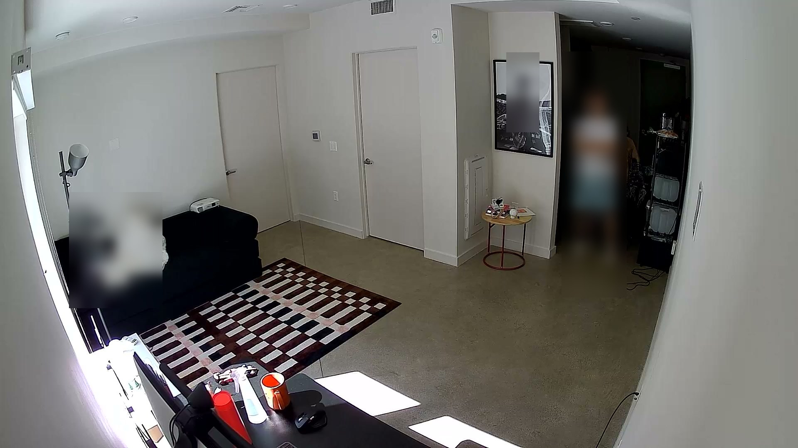
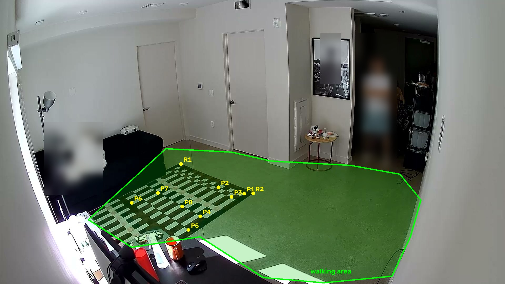
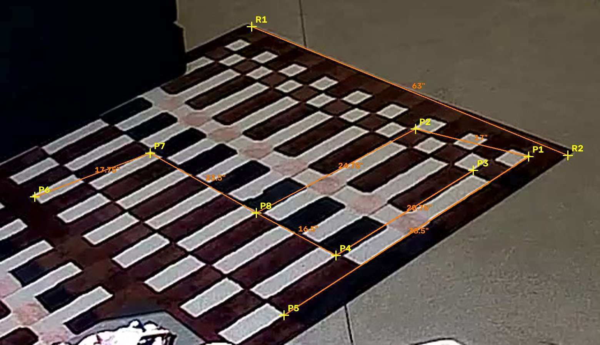
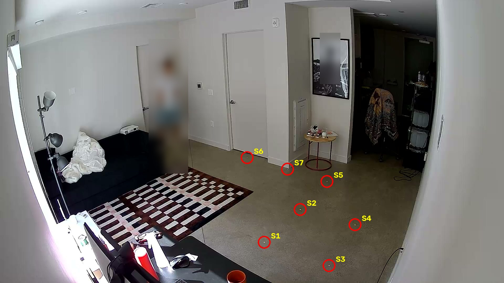
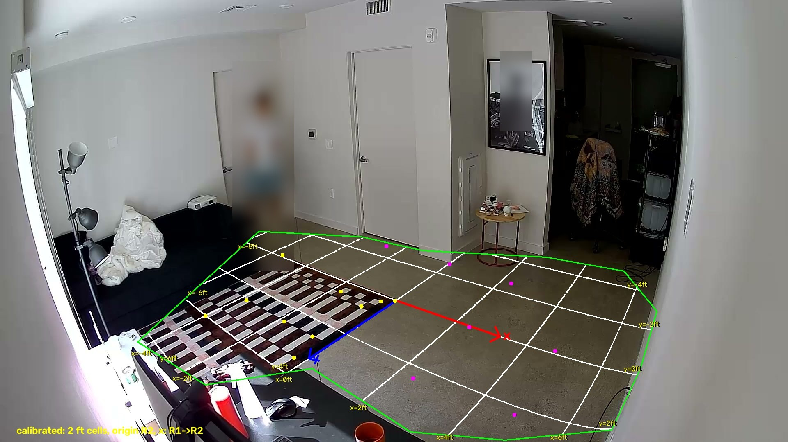
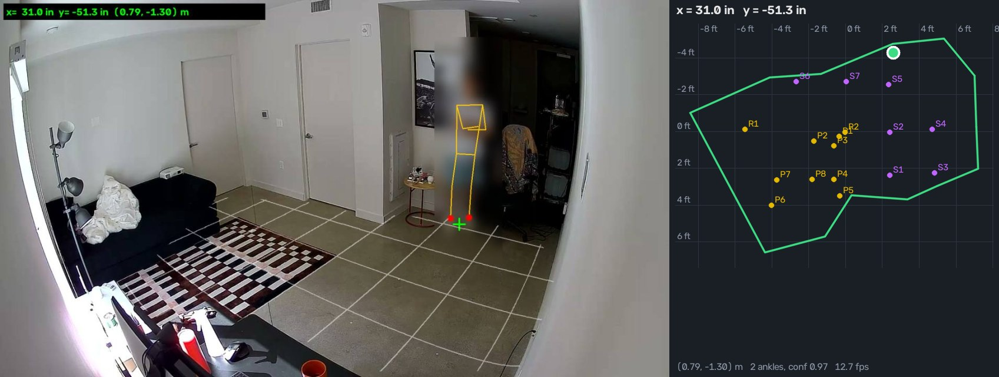

# Project Proposal (Draft): Non-Visual, Low-Power Sensing of Social Interaction

Joseph Seok, Ziang Xue

## Question

How well can low-power, non-visual sensing (microphone arrays, optionally UWB) detect social interaction within a room, **running entirely on-device with no data sent to any server**, and how does it compare to a vision-based approach in accuracy and energy cost?

## Scope

We will design, train, and deploy an AI model on an embedded device that takes multi-channel acoustic signals from a microphone array and, in a single indoor room with up to ~10 people (primary evaluation at ~4-6), 

1. detects conversation subgroups (typically 2-3), and
2. assigns each person a **persistent anonymous identifier**, so the same person can be tracked across a session even as they move or switch groups.

All inference runs on the device itself; no raw data is sent to a cloud or data center. Identifiers do not correspond to real identities and are only valid within a single session. The model architecture is part of the project and is not fixed in advance.

**Stretch goal:** Add a UWB tag per person as an additional input, and measure whether and how much it improves subgroup detection over acoustic-only.

**Known limitation:** Acoustic sensing only detects people who speak. Silent individuals cannot be assigned to a group, so evaluation is defined over active speakers.

## Methodology (high level)

1. **Simulation.** Generate multi-channel acoustic data (and ground-truth groups, IDs, positions) with pyroomacoustics, driven by a simulated behavior model of group formation, switching, and turn-taking. Train and explore model architectures on a PC. Zephyr's simulation targets can be used for early on-device pipeline testing before physical deployment.
2. **On-device deployment.** Deploy the trained model to an embedded platform with a microphone array, and measure latency, memory, and energy.
3. **Real-world validation.** Deploy in a lab / office-hour setting with consent, and compare device output against human-annotated ground truth (with video as a reference).

## Evaluation

**Form.** Two axes, compared against a vision-based baseline to characterize the accuracy-energy tradeoff:

- **Accuracy:** how reliably the system recovers the correct subgroups (e.g., "persons A, B, C are in the same group"), and keeps anonymous IDs consistent over time.
- **Energy / resource cost:** power, latency, and memory on the embedded device.

**Ground truth.**

- *Simulation:* known by construction (group membership, IDs, positions, speech activity).
- *Real-world:* human annotation of group membership over time, made by annotators (not participants) reviewing video.

**Experiments.**

1. *Simulation:* vary conditions (number of people/groups, speech overlap, reverberation, noise) to see how accuracy degrades and where the system fails.
2. *Real-world deployment:* run the device live in the target setting and compare its output to human-annotated ground truth. This is the final evaluation.
3. *Energy:* measured on the real device, since simulation cannot give true power numbers.

**Reporting.** Simulation and real-world results are reported separately; the gap between them is itself a result. Specific metrics will be chosen later.

## Constraints

- Real data will be limited, hence the simulation-heavy development and a small number of real sessions.
- Real recordings require appropriate consent / approval.

## Questions for Mani

1. **Consent / IRB:** We plan to record multi-channel audio (and possibly video) of classmates in a lab setting. Do we need IRB approval or written consent, and what is the process?
2. **Hardware:** Is the bar for "embedded" MCU-level, Pi-level, or either?
3. **Scope boundary:** What level of completion would you consider solid for the core project? Is UWB acceptable as a stretch goal?
4. **Baseline:** Do we need a vision baseline, and should we implement it ourselves or use an off-the-shelf model and measure its energy?
5. **Simulation:** We plan to use pyroomacoustics. Any other tools you'd suggest? Is a simulation-heavy plan with a small number of real sessions for final validation reasonable?
6. **Real evaluation scale:** Are one or two real sessions sufficient as the final evaluation?
## Feasibility Testing

Before building the audio models, we are checking whether a speaker's 2D position can be estimated from a few separate single-microphone devices (plan and scope: [feasibility/feasibility_test.md](feasibility/feasibility_test.md)). Training and evaluating that needs a position label for every moment of every recording, so the first thing we built is a **ground-truth system**: an ordinary wall camera plus a YOLO pose model that reports where a person stands on the floor, live, in meters. The camera is used only to produce labels during data collection, never at inference time.

**Status:** the camera calibration and the live tracker work. We have not yet recorded audio, and the tracker has not yet been evaluated on a person walking across the room (see [Not done yet](#not-done-yet)).

### Hardware and software setup

| Part | Role |
|---|---|
| Aqara G100 camera, wall mounted | 1920×1080 H.264 at 20 fps, streamed over Wi-Fi as local RTSP (port 8554, TCP). Wide-angle lens with visible barrel distortion |
| Mac (Apple silicon) | Receives the stream and runs everything: YOLO11m-pose on the Apple GPU at 1280 px (about 48 ms per frame, ~20 fps, ~60 ms end-to-end lag), the calibration math, and the web server |
| Tape measure, floor stickers, the room's rug | Calibration landmarks |
| 2 iPhones + 1 iPad *(planned)* | The three single-microphone nodes for the later recording sessions |

```
camera --RTSP--> OpenCV capture --> YOLO pose --> ankle pixels --> calibrated floor mapping --> (x, y) in the room
                                                                                                   |
                          browser: video + top-down map  <--- MJPEG / server-sent events <---------+---> CSV log (timestamped labels)
```

Everything specific to one room (landmark pixels, measurements, camera URL) lives in a *preset* directory, [feasibility/presets/apartment/](feasibility/presets/apartment/), and the code in [feasibility/tools/](feasibility/tools/) is generic. Another room needs only its own preset (template in [feasibility/presets/_template/](feasibility/presets/_template/)).

### Building the calibrated grid

The goal is a mapping from a pixel in the camera image to a floor position in meters. We had no checkerboard, so we calibrated with objects already in the room.

**1. Look at the camera view.** The lens bends straight lines near the edges, so a plain pixel-to-floor homography would be wrong away from the center.



**2. Pick landmarks on the rug.** The rug's block pattern gives many crisp corners. We detected the white blocks by contour fitting and picked the rug's two visible corners (R1, R2) and eight block corners (P1–P8), each pinned to an exact pixel. The green polygon is the walkable area we want to cover.



**3. Measure distances between them.** With a tape measure we measured pairs of landmarks (orange). The rug's manufacturer size, 5'3", gave R1–R2. One measurement (P4–P5) contradicted the others, so it is left out and flagged for re-measuring.



**4. Fit a camera model.** We fit a pinhole camera over a flat floor with one radial-distortion term. The unknowns are focal length, pitch, roll, camera height, the distortion coefficient, and each landmark's floor position. They are solved by least squares from the landmark pixels, the measured distances, and one fact about the rug: it is a rectangle, so R1→R2 is perpendicular to its other edge. That last constraint matters: without it the fit looked good on the rug but the grid was skewed.

**5. Check it on the bare floor with stickers.** The rug alone cannot constrain the distortion far from itself. We placed seven stickers on the floor, found them in the image automatically (small white blobs about 8×5 px), and measured 12 distances to and between them. These were first used as a test of the rug-only model, then added to the fit.



**6. The result.** The floor frame has its origin at the rug's right corner R2, x along R1→R2, and y along the rug's other edge. Each grid cell is 2 ft.



| Test (error in the predicted distance between landmarks) | RMS | Worst |
|---|---|---|
| Rug-only model, predicting the 12 sticker distances (no distortion term) | 1.93 in | 3.26 in |
| Final model, all 20 measured distances (fit error) | 0.29 in | 0.88 in |
| Final model, leave-one-out (drop a sticker distance, refit, predict it) | 0.62 in (1.6 cm) | 1.40 in |

The leave-one-out row is the honest estimate of how far off a new distance will be. Limits:

- The stickers are all in the right and front part of the room, so the left side and the far corners are not checked and will be less accurate.
- The fitted camera height (about 2.0 m) is an effective value of the model, not a measurement.
- The calibration is only valid while the camera does not move.
- Only distances were validated, not absolute positions.

### Live tracking

[feasibility/tools/track_server.py](feasibility/tools/track_server.py) serves a web page on port 9090 of the Mac, reachable from any device on the same network. It shows the annotated video, the optional calibrated grid, a top-down map with the last 12 seconds of the path, and the position in inches and meters.



*Output of the real server on a recorded frame replayed as the camera input, with the person blurred by the server's `--blur` option. It is a single still frame, not a walk.*

How the position is computed:

- **Feet, not footwear.** The pose model finds the ankles from the shape of the body, so slippers or bare feet make no difference. The position is the midpoint of the two ankles in the floor frame. If only one ankle is visible, that one is used.
- **Ankle height.** An ankle is a few centimeters above the floor, so its ray is intersected with a plane 8 cm up, which puts the point under the ankle (`ankle_height_m` in the preset).
- **Smoothing and tracking.** A One Euro filter smooths when the person is still and follows quickly when they move. The tracker locks onto one person and rejects other detections that jump too far, such as a ghost detection on a chair.
- **Labels.** `--log auto` writes timestamped positions, which become the position labels for later recordings.
- **Privacy.** `--blur` pixelates every detected person in the streamed video. The server has no password, so only run it on a trusted network.

Commands (from `feasibility/`, details in [feasibility/README.md](feasibility/README.md)):

```
python tools/calib.py report            # calibration accuracy
python tools/calib_export.py            # write the calibration for the tracker
python tools/track_server.py --log auto # live tracker at http://<this Mac's IP>:9090
python tools/adhoc/make_figures.py      # regenerate the figures above, people blurred
```

### Recorded sessions and the synced dataset

Three sessions (about 9, 10 and 7 minutes) were recorded: three phones on the floor in a triangle (A, B, C at measured
positions) and the camera recording the video. The video was tracked offline, and the phones were put on one clock using
the three claps at the start of each session (hand closings found in the video give the link to the positions):

- Phone-to-phone clock offsets are known to about 0.5 ms at the claps.
- Audio to position is good to about 40 ms (one video frame).
- Each session is a 3-channel WAV plus a positions file in one time base, in `feasibility/presets/apartment/dataset/`.
- **Clock drift is not corrected.** There were no claps at the end of any session, and the speech and the mains hum in the
  recordings were too noisy to measure drift. The error grows with the time since the claps. A phone 5 ppm off is 2.7 ms
  (0.9 m of path difference) off after 9 minutes. The start of each session is the most reliable.
- The sessions cover mostly the middle of the room (about half of the floor). Session 3 was planned to fill the gaps.

### Not done yet

- Measure each phone's clock drift: one recording of about 10 minutes with claps at both ends would do it, since a phone's
  clock rate is a property of the phone.
- Evaluate the tracker against known floor points while walking, including the label error when moving.
- Run the baselines and learned models from the plan on the dataset.
- Go/no-go criteria for the feasibility test (to be set with Mani).
